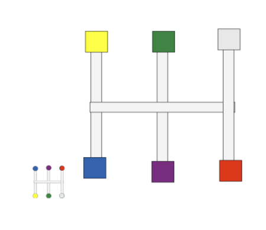

# Cupboards

[In English](README.md)

### Задание: Мини-игра “Cupboards”

* Задано следующее расположение фишек (на рисунке они обозначены цветными квадратами).
* Цель игры заключается в том, чтобы перемещением фишек добиться заданного расположения (рисунок в левом нижнем углу).
* Фишки можно перемещать только по путям, указанным на рисунке (всего 9 возможных точек для расположения фишек).
* Фишку невозможно передвинуть сквозь другую фишку на ее пути.



### Требования к реализации:
1. Язык программирования: C++.
    - Стандарт: C++17.
    - Использовать С++/CX и C++/CLI нельзя.
2. Передвижение фишек должно происходить плавно.
3. За один ход фишка может перемещаться через несколько соединений, если указанный пользователем путь свободен от других фишек.
4. Места, куда пользователь может передвинуть выбранную фишку , должны подсвечиваться.
5. Выбранная фишка должна подсвечиваться.
6. Расположение фишек и топология уровня (соединения) должны быть заданы во внешнем текстовом файле (расположение, количество фишек и пути могут быть любыми, на рисунке показан лишь один из вариантов!).
7. Управление мышью.
8. Расчет путей должен происходить программно.;
9. Обязательно наличие программной архитектуры(ООП-подход).
10. Программа должна содержать несколько вариантов входных файлов с разным количеством фишек и соединений.

Ниже приведен пример входного файла, соответствующий приведенному выше рисунку (координаты точек можно менять по своему усмотрению):

```text
6
9
100,100
200,100
300,100
100,200
200,200
300,200
100,300
200,300
300,300
1,2,3,7,8,9
7,8,9,1,2,3
8
1,4
2,5
3,6
4,5
5,6
4,7
5,8
6,9
```

Пояснения:

- 1 строка - количество фишек;
- 2 строка - количество точек, куда можно поместить фишку;
- 3-11 строка - координаты точек, куда можно поместить фишку;
- 12 строка - начальное расположение фишек по точкам;
- 13 строка - выигрышное положение фишек по точкам;
- 14 строка - количество соединений;
- 15-22 строка - список соединений между парами точек.

### Сборка

```shell
cmake -S . -B build
cmake --build build
```